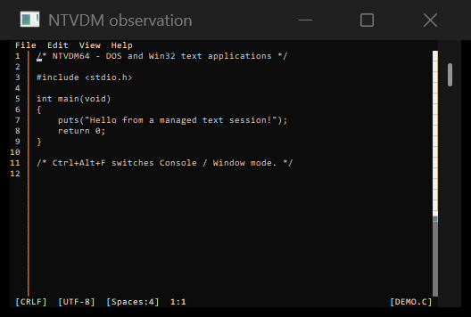
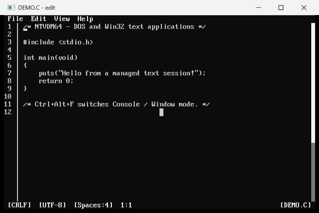
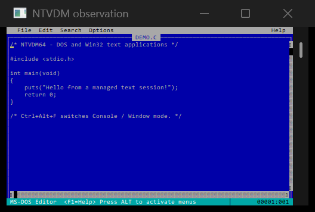
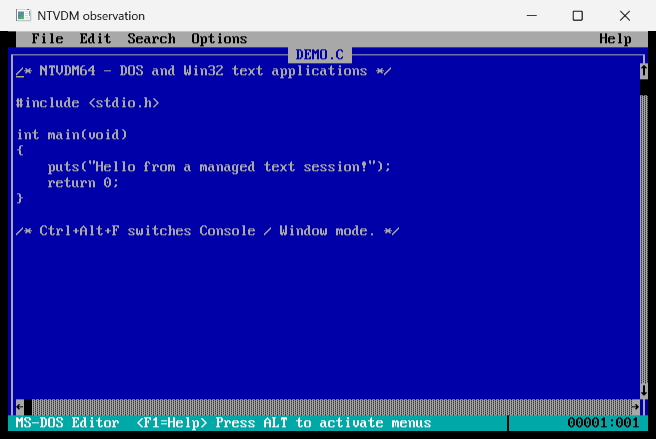
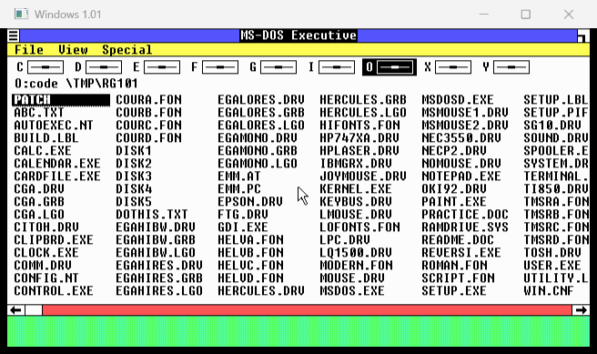
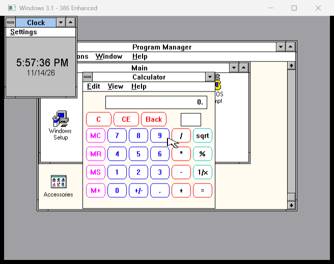
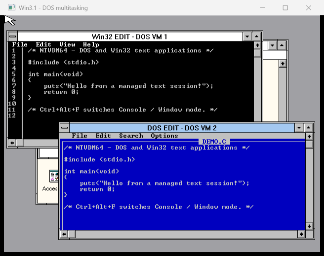
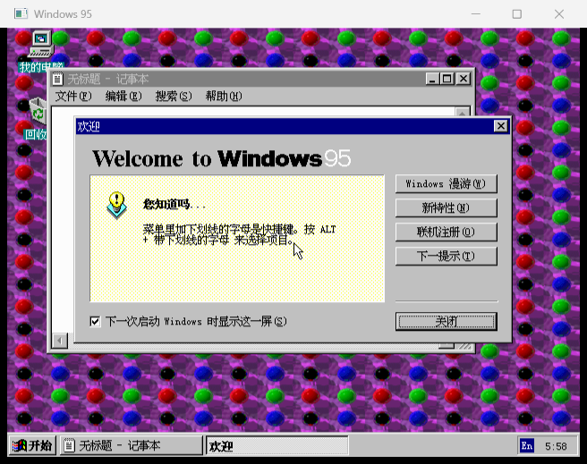

# NTVDM64

**DOS, Win16 and native Win32 text programs on modern 64-bit Windows.**

NTVDM64 brings the OpenNT NTVDM and SoftPC software CPU into a managed,
standalone runtime. DOS programs run inside an emulated machine; native Win32
text programs run on the host. Both share a Console / Window frontend, with
**Ctrl+Alt+F** to switch between the two.

The project also runs guest Windows 1.01, Windows 3.1 and selected Windows 95
installations. This is an actively developed compatibility project: a working
desktop is a milestone, not a promise that every application or device works.

## See it running

These are actual runtime captures, not mockups. The gallery uses the same
published runtime package throughout; [capture details](assets/screenshots/runtime-gallery/manifest.json)
record its identity, the launch profiles and the verification boundaries.

### One frontend, two kinds of text program

| | Console mode | Window mode |
| --- | --- | --- |
| **Win32 `edit.exe`** — native Microsoft Edit |  |  |
| **DOS `EDIT.COM`** — guest DOS Editor |  |  |

### Windows 1.01

The original graphical environment, running inside the software-emulated guest.



### Windows 3.1

386 Enhanced Mode, with Program Manager, Calculator and Clock.



### Multiple DOS windows inside Windows 3.1

The enhanced-mode integration connects guest DOS windows with managed program
execution. This scene shows two DOS VM windows running native Win32 Edit and DOS
Editor side by side inside one guest Windows desktop.



### Windows 95

An adapted, already installed Windows 95 guest reaching its graphical desktop.
The current toolkit prepares an installation for launch; it is not a general
Windows 95 installer.



## Run a program

Use `run16.exe` from a coherently deployed runtime package. Examples below
assume its launcher is on `PATH` and the target programs are available:

```bat
run16 command
run16 cmd
run16 O:\WINNT\EDIT.COM
run16 O:\WINNT\edit.exe
run16 --wait .\program.exe arguments
run16 .\program.pif
ntmon
```

- `command` starts the supplied DOS command interpreter; `cmd` starts a native
  Windows command interpreter. They are different execution environments.
- **Ctrl+Alt+F** switches the active frontend between Console and Window mode.
- PIF launch profiles carry program arguments and guest configuration.
- `ntmon` shows managed workers and their tasks through the service.

Guest Windows needs its own prepared files and launch profile. The companion
CMD toolkits provide reversible preparation workflows:

| Toolkit | Purpose |
| --- | --- |
| [win101-setup](tools/win101-setup) | Prepare Windows 1.01 installation media and launch profiles. |
| [win31-setup](tools/win31-setup) | Prepare Windows 3.1 media, run the original installer, and generate installed launch profiles. |
| [win95-launch](tools/win95-launch) | Prepare a supported **existing** Windows 95 installation for launch. |

Start with the toolkit's instructions and `APPLY.CMD`; keep the original media
intact. Installation paths in the screenshots are local test copies, not
required product paths. Guest media and Microsoft components follow the
[source policy](docs/etc/operations/policy/source-policy.md).

## How it fits together

The runtime is a cooperating set of executables, not the old single
`ntvdm32.exe` build.

| Component | Role | Host architecture |
| --- | --- | --- |
| `run16.exe` | Program launcher and completion waiting | x64 |
| `ntsrv.exe` | Task admission, lifecycle records and worker coordination | x64 |
| `ntcon.exe` | Shared Console / Window presentation and input frontend | x64 |
| `ntvdm.exe` | DOS machine, SoftPC CCPU40 CPU emulation, guest Windows and Win16 execution | x86 |
| `ntvwm.exe` | Native Win32 text-program worker | x64 |
| `ntmon.exe` | Task monitor, querying `ntsrv` | x64 |
| `WOW32.DLL`, `VDMREDIR.DLL`, `VCDEX.DLL` | Selected NTVDM support providers | x86 |
| `nthook32.dll`, `nthook64.dll` | Managed process integration for the corresponding architecture | x86 / x64 |

The CPU is emulated in software; the product does not depend on hardware V86
mode. Running a complete guest Windows desktop and running an individual Win16
application through WOW are distinct paths, with different compatibility limits.

For Windows 3.1 enhanced-mode integration, `INSIGNIA.386` and the independently
implemented `NTVDM64.386` have separate responsibilities. The latter provides
the optional host payload bridge. DOS-only execution and host-backed commands
are different modes; the multi-window screenshot does not imply that every
host console program can transparently run in every guest DOS VM.

## Build

Use Windows with MSVC and the Windows SDK, CMake 3.25 or newer, Ninja,
PowerShell 7 (`pwsh`) and Node.js. Guest add-ons and relevant test fixtures also
use NASM. Configure each architecture from its matching Visual Studio developer
environment.

In an **x86** developer shell:

```bat
cmake --preset msvc-x86-release
cmake --build --preset msvc-x86-release --target wow32
```

In an **x64** developer shell:

```bat
cmake --preset msvc-x64-release
cmake --build --preset msvc-x64-release --target native-worker native-frontend native-monitor native-launcher native-service hook64
```

The `wow32` target also builds its x86 worker dependency. Presets reuse the
architecture-specific trees under `build/.ninja/`; optional `-ccache` presets
are available. These are source build entrypoints, not a one-command runtime
installer: a runnable package also needs the matching support binaries and
admitted guest files. Do not mix images from unrelated builds.

See [CONTRIBUTING.md](CONTRIBUTING.md) for build conventions and verification,
and [current status](docs/states/CURRENT.md) for the current delivery baseline.

## Compatibility and development

- Guest Windows requires the appropriate prepared installation and drivers;
  arbitrary unmodified media is not a compatibility guarantee.
- Windows 95 support remains experimental, including application and shutdown
  gaps. The screenshot demonstrates desktop startup only.
- Original DOS components retain some historical limits, including long
  environment / `PATH` problems. The gallery uses a controlled short environment.
- Win16 application compatibility, enhanced-mode multitasking and input/display
  transitions remain areas of active testing.

The [known issues](docs/states/TODO.md) and [task queue](docs/states/QUEUE.md)
track limitations and planned work. For implementation details, start with the
[documentation guide](docs/README.md), [architecture](docs/design/ARCHITECTURE.md)
and [source policy](docs/etc/operations/policy/source-policy.md).
